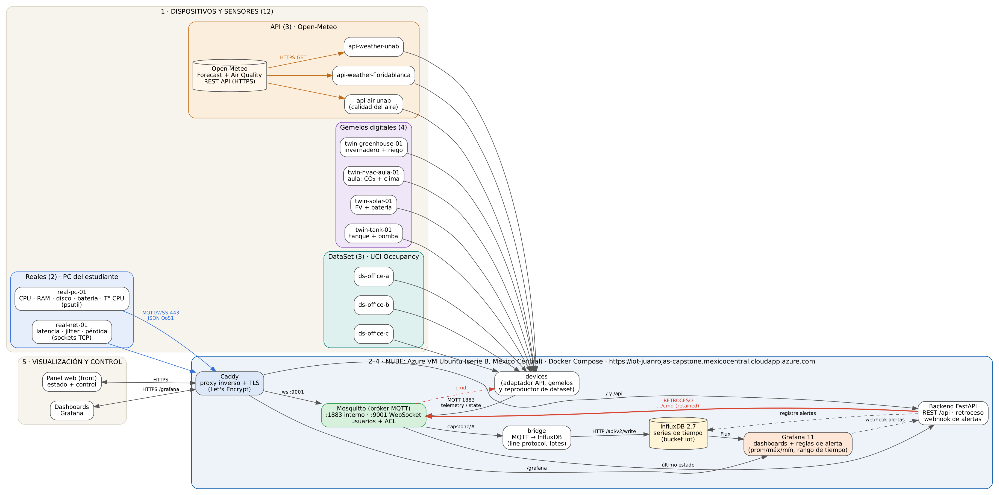

# IoT a la medida — Campus inteligente UNAB

Plataforma en línea: <https://iot-juanrojas-capstone.mexicocentral.cloudapp.azure.com> · Grafana: <https://iot-juanrojas-capstone.mexicocentral.cloudapp.azure.com/grafana/>

**Parcial 2 · Proyecto final · Juan Camilo Rojas (U00178034)**

Plataforma IoT propia desplegada en Azure con **12 dispositivos** de cuatro tipos (2 reales, 3 API, 4 gemelos digitales y 3 DataSet). Usa MQTT con autenticación y ACL, almacena en InfluxDB, visualiza en Grafana con alertas, y tiene **retroceso**: cada dispositivo se puede apagar, encender, calibrar o ajustar desde la web.



## Componentes
| Ruta | Qué es |
|---|---|
| `docker-compose.yml` | Stack completo: Caddy, Mosquitto, InfluxDB, Grafana, bridge, backend, devices |
| `services/devices/` | Dispositivos: `real_devices.py` (corre en tu PC), `api_devices.py`, `twins.py`, `dataset_devices.py`, `run_cloud.py` |
| `services/bridge.py` | MQTT → InfluxDB (line protocol por lotes) |
| `services/backend.py` + `static/` | API REST (FastAPI) y panel web de control |
| `services/exportar.py` | Exporta gráficas y estadísticas de la toma de datos |
| `grafana/` | Datasource, dashboards y reglas de alerta como código |
| `mosquitto/` | Configuración del bróker y ACL |
| `caddy/Caddyfile` | HTTPS automático con dominio propio |
| `infra/` | Despliegue y borrado en Azure (`deploy_azure.sh`, `cloud-init.yaml`, `apagar_azure.sh`) |
| `scripts/setup.sh` | Genera secretos, levanta el stack y pre-carga historial |

## Temas MQTT
```
capstone/<tipo>/<dispositivo>/telemetry   dispositivo → nube   QoS 1
capstone/<tipo>/<dispositivo>/state       dispositivo → nube   QoS 1, retained
capstone/<tipo>/<dispositivo>/cmd         nube → dispositivo   QoS 1, retained (retroceso)
```
Ejemplo de telemetría: `{"device":"twin-hvac-aula-01","kind":"twin","ts":1794788631995,"values":{"room_temp_c":24.1,"co2_ppm":812,...}}`

Comandos de retroceso: `{"power":"off"}`, `{"period_s":10}`, `{"offset":{"cpu_pct":-2}}`, `{"gain":{"pm2_5":1.05}}`, `{"setpoint":{"setpoint_c":22}}`, `{"reset":true}`.

## Despliegue (Azure)
```bash
git clone https://github.com/jrojas710/iot-capstone && cd iot-capstone
REPO=https://github.com/jrojas710/iot-capstone LOC=mexicocentral ./infra/deploy_azure.sh
```
Crea una VM Ubuntu (serie B, 2 vCPU) con un DNS propio, abre los puertos 80 y 443, instala Docker, clona el repo, genera los secretos, levanta el stack y pre-carga 5 días de historial de los gemelos y del dataset, más el historial horario real de la API (Open-Meteo, `past_days`). Los datos de acceso quedan en `despliegue.txt`, que no se sube al repo.

## Dispositivos reales (en tu computador)
```bash
pip install -r services/requirements-real.txt
python services/devices/real_devices.py --host <dominio> --password <MQTT_REAL_PASSWORD>
```

## Retroceso por API
```bash
curl -X POST https://<dominio>/api/devices/twin-hvac-aula-01/cmd \
  -H "X-Api-Key: <ADMIN_TOKEN>" -H "Content-Type: application/json" -d '{"setpoint":{"setpoint_c":21}}'
```

## Evidencias
```bash
docker compose run --rm -v "$PWD/evidencias:/app/evidencias" backend python exportar.py --days 6
```

## Fuentes de datos
- Open-Meteo Forecast y Air Quality API (condiciones actuales, historial horario y calidad del aire). Azure Maps queda como proveedor alterno (`API_PROVIDER=azure`).
- Candanedo, L. M. & Feldheim, V. (2016). *Occupancy Detection Data Set*. UCI Machine Learning Repository.
