**Repositorio:** <https://github.com/jrojas710/iot-capstone>  
**Plataforma (URL propia):** <https://iot-juanrojas-capstone.mexicocentral.cloudapp.azure.com> · Grafana: `/grafana` · API: `/api/docs`

# 1. Descripción y contexto

El escenario es un **campus universitario inteligente en Bucaramanga (UNAB)**. Una sola plataforma reúne la información ambiental y de infraestructura del campus para tomar decisiones de confort, ahorro de energía y agua y salud ambiental:

- **Clima y calidad del aire** del campus y de Floridablanca, a partir del servicio meteorológico abierto Open-Meteo (observaciones horarias y modelo de calidad del aire CAMS).
- **Infraestructura simulada por gemelos digitales:** un invernadero con riego automático, un aula climatizada con control de CO₂, un sistema solar con batería para una caseta y un tanque de agua con bomba. Los gemelos usan como entrada el clima real de la API.
- **Oficinas con sensores ambientales** de ocupación, CO₂, luz, temperatura y humedad, reproducidas desde un dataset científico público.
- **Equipos reales:** el computador del estudiante, que mide su propio estado (CPU, RAM, batería y temperatura) y la calidad de su conexión a Internet.

Cada dispositivo es controlable desde la nube (**retroceso**): se puede apagar, encender, cambiar su periodo de muestreo, calibrar con offset o ganancia y ajustar sus consignas (por ejemplo, la temperatura objetivo del aula o el umbral de riego).

# 2. Arquitectura de referencia IoT

```{=openxml}
<w:p><w:r><w:br w:type="page"/></w:r></w:p>
```

{height=20cm}

| Capa | Componentes | Función |
|---|---|---|
| 1. Dispositivos y sensores | 2 reales, 3 API, 4 gemelos, 3 DataSet | Generan las variables (12 dispositivos, 56 variables) |
| 2. Comunicación | MQTT 3.1.1 (TCP 1883 y WebSocket TLS 443), HTTPS REST | Envío de telemetría y recepción de comandos |
| 3. Plataforma / bróker | Mosquitto con usuarios y ACL, Caddy (TLS) | Enrutamiento publicar/suscribir, seguridad y punto de entrada único |
| 4. Procesamiento y almacenamiento | Bridge Python, InfluxDB 2.7, backend FastAPI | Persistencia de series de tiempo, API de control y registro de alertas |
| 5. Visualización y control | Grafana 11, panel web propio | Dashboards con promedio, máximo y mínimo, alertas y retroceso |

# 3. Tecnologías seleccionadas

## 3.1 Sensores y dispositivos

| # | Dispositivo | Protocolo | Variables (unidad, rango) | Periodo |
|--|------------------|-------------|------------------------------------------------|------|
| 1 | **real-pc-01** — Real: Equipo del estudiante | MQTT/WSS (TLS 443) | cpu_pct (%, 0–100) · ram_pct (%, 0–100) · disk_pct (%, 0–100) · battery_pct (%, 0–100) · cpu_temp_c (°C, 30–100) · plugged_in (0/1, 0–1) | 30 s |
| 2 | **real-net-01** — Real: Conexión a Internet | MQTT/WSS (TLS 443) | latency_ms (ms, 0–500) · jitter_ms (ms, 0–200) · loss_pct (%, 0–100) | 30 s |
| 3 | **api-weather-unab** — API: Clima UNAB | HTTPS REST → MQTT | temperature_c (°C, 10–35) · humidity_pct (%, 20–100) · pressure_mb (hPa, 880–1025) · wind_kmh (km/h, 0–40) · uv_index (índice, 0–14) · cloud_cover_pct (%, 0–100) · precip_mm (mm/h, 0–30) | 600 s |
| 4 | **api-weather-floridablanca** — API: Clima Floridablanca | HTTPS REST → MQTT | temperature_c (°C, 10–35) · humidity_pct (%, 20–100) · pressure_mb (hPa, 880–1025) · wind_kmh (km/h, 0–40) · uv_index (índice, 0–14) · cloud_cover_pct (%, 0–100) · precip_mm (mm/h, 0–30) | 600 s |
| 5 | **api-air-unab** — API: Calidad del aire UNAB | HTTPS REST → MQTT | aqi (índice, 0–300) · pm2_5 (µg/m³, 0–150) · pm10 (µg/m³, 0–250) · o3 (µg/m³, 0–200) · no2 (µg/m³, 0–200) · co (µg/m³, 0–2000) | 900 s |
| 6 | **twin-greenhouse-01** — Gemelo: Invernadero con riego | MQTT (QoS 1) | air_temp_c (°C, 15–40) · rel_humidity_pct (%, 30–100) · soil_moisture_pct (%, 0–100) · light_lux (lux, 0–60000) · irrigation_on (0/1, 0–1) | 60 s |
| 7 | **twin-hvac-aula-01** — Gemelo: Aula climatizada | MQTT (QoS 1) | room_temp_c (°C, 18–32) · co2_ppm (ppm, 400–2000) · occupancy (personas, 0–40) · hvac_power_kw (kW, 0–5) · setpoint_c (°C, 18–28) | 60 s |
| 8 | **twin-solar-01** — Gemelo: Panel solar + batería | MQTT (QoS 1) | irradiance_wm2 (W/m², 0–1100) · pv_power_w (W, 0–1200) · load_w (W, 0–900) · battery_soc_pct (%, 0–100) · load_shed (0/1, 0–1) | 60 s |
| 9 | **twin-tank-01** — Gemelo: Tanque + bomba | MQTT (QoS 1) | level_pct (%, 0–100) · inflow_lpm (L/min, 0–60) · outflow_lpm (L/min, 0–40) · pump_on (0/1, 0–1) | 60 s |
| 10 | **ds-office-a** — DataSet: Oficina A (UCI) | CSV → MQTT | temperature_c (°C, 19–25) · humidity_pct (%, 16–40) · light_lux (lux, 0–1700) · co2_ppm (ppm, 410–2080) · humidity_ratio (kg/kg, 0.0026–0.0065) · occupancy (0/1, 0–1) | 60 s |
| 11 | **ds-office-b** — DataSet: Oficina B (UCI) | CSV → MQTT | temperature_c (°C, 19–25) · humidity_pct (%, 16–40) · light_lux (lux, 0–1700) · co2_ppm (ppm, 410–2080) · humidity_ratio (kg/kg, 0.0026–0.0065) · occupancy (0/1, 0–1) | 60 s |
| 12 | **ds-office-c** — DataSet: Oficina C (UCI) | CSV → MQTT | temperature_c (°C, 19–25) · humidity_pct (%, 16–40) · light_lux (lux, 0–1700) · co2_ppm (ppm, 410–2080) · humidity_ratio (kg/kg, 0.0026–0.0065) · occupancy (0/1, 0–1) | 60 s |

**Resumen:** 12 dispositivos (2 reales, 3 API, 4 gemelos digitales, 3 DataSet), todos con varias variables, comunicación MQTT y retroceso.

## 3.2 Comunicación: bróker y protocolo

**Bróker:** Eclipse Mosquitto 2.0. Rechaza conexiones anónimas y tiene cuatro usuarios con permisos mínimos: `bridge` (solo lectura), `backend` y `cloud-devices` (lectura y escritura) y `real-device`. Este último solo puede publicar en `capstone/real/+/telemetry|state` y leer `capstone/real/+/cmd`.

**Protocolo:** MQTT con mensajes JSON.

- **Envío** (dispositivo → nube): `capstone/<tipo>/<id>/telemetry` con QoS 1, que garantiza que el mensaje llegue al menos una vez. El estado del dispositivo va en `.../state` como mensaje retenido.
- **Recepción** (nube → dispositivo): `capstone/<tipo>/<id>/cmd` con QoS 1 y **retained**. Si el dispositivo está desconectado, aplica el último comando cuando se reconecta.
- **Transporte:**
  - Los dispositivos reales salen de una red doméstica, así que usan **MQTT sobre WebSocket con TLS** (`wss://iot-juanrojas-capstone.mexicocentral.cloudapp.azure.com/mqtt`, puerto 443).
  - Los servicios internos usan **MQTT/TCP 1883** dentro de la red de Docker.
  - Los dispositivos API consultan Open-Meteo por **HTTPS REST** (`GET /v1/forecast?current=...` y `GET /v1/air-quality?current=...`) y un adaptador traduce la respuesta a MQTT. El adaptador también soporta Azure Maps Weather (`API_PROVIDER=azure`), pero la llave entregada para el curso respondía `401 Unauthorized` y la suscripción Azure for Students no permite crear una cuenta propia de Azure Maps en ninguna región habilitada, así que se usó Open-Meteo, que no requiere llave.

Ejemplo de mensaje:
```
capstone/twin/twin-hvac-aula-01/telemetry
{"device":"twin-hvac-aula-01","kind":"twin","ts":1794788631995,
 "values":{"room_temp_c":24.1,"co2_ppm":812,"occupancy":28,"hvac_power_kw":2.3,"setpoint_c":23}}
```

## 3.3 Nube y servicios utilizados

Infraestructura propia en **Microsoft Azure** (Azure for Students):

- **Máquina:** una VM Ubuntu 24.04 de 2 vCPU y 4 GB (serie B) en la región **México Central**, con IP pública y un nombre DNS propio (`iot-juanrojas-capstone.mexicocentral.cloudapp.azure.com`). La región se eligió porque la política de la suscripción Azure for Students solo permite westus, mexicocentral, brazilsouth, centralus y chilecentral. El grupo de seguridad de red solo abre los puertos 80 y 443.
- **Despliegue:** se hace con Azure CLI y cloud-init (`infra/deploy_azure.sh`).
- **Contenedores:** todo el stack corre con Docker Compose.

| Servicio | Imagen / tecnología | Rol |
|---|---|---|
| caddy | Caddy 2.8 | Proxy inverso y certificado HTTPS automático (Let's Encrypt) |
| mosquitto | Eclipse Mosquitto 2.0 | Bróker MQTT (TCP y WebSocket) |
| devices | Python 3.12 | Adaptador de la API Open-Meteo, 4 gemelos y 3 reproductores de dataset |
| bridge | Python 3.12 | Suscriptor `capstone/#` que escribe en InfluxDB por lotes |
| influxdb | InfluxDB 2.7 | Base de datos de series de tiempo (retención de 60 días) |
| backend | FastAPI + Uvicorn | API REST, retroceso, caché del último estado y webhook de alertas |
| grafana | Grafana OSS 11.2 | Dashboards y reglas de alerta, provisionados como código |
| Open-Meteo | Forecast y Air Quality REST API | Fuente de los dispositivos API (sin llave) |

## 3.4 Visualización y procesamiento de los datos

- **Dashboard "Visión general":**
  - número de dispositivos que reportaron en los últimos 20 minutos;
  - tabla con el estado actual de cada dispositivo (encendido o apagado, periodo);
  - alertas registradas;
  - gráficas comparativas: temperatura de todas las fuentes, humedad, CO₂, CPU/RAM y latencia de los equipos reales, PM2.5/PM10, energía solar, nivel de agua y luz de las oficinas.
- **Dashboard "Detalle por dispositivo":**
  - selector de dispositivo y de variables;
  - **tabla con promedio, máximo, mínimo, último valor y número de muestras** del rango seleccionado;
  - línea de estado (encendido/apagado) que evidencia el retroceso;
  - una gráfica por variable con **promedio, máximo y mínimo** por ventana.
- **Ajuste de tiempo:** el selector de Grafana (por defecto *últimos 6 días*) recalcula todas las estadísticas y la agregación (`aggregateWindow` según `v.windowPeriod`).
- **Alertas y reglas** (Grafana Alerting): se evalúan cada minuto y deben sostenerse 2 minutos para dispararse. La notificación va por webhook al backend, que la registra en InfluxDB.

| Regla | Condición |
|---|---|
| CPU alta (real-pc-01) | promedio de 10 min > 85 % |
| Latencia alta (real-net-01) | > 150 ms |
| PM2.5 (api-air-unab) | > 35 µg/m³ |
| Invernadero caliente | > 32 °C |
| CO₂ en el aula | > 1000 ppm |
| Batería solar baja | SOC < 20 % |
| Tanque casi vacío | nivel < 15 % |
| CO₂ en la oficina C (dataset) | > 1200 ppm |

**Retroceso:** se usa desde el panel web (`/`) o desde la API (`POST /api/devices/{id}/cmd` con llave de administración).

| Comando | Efecto |
|---|---|
| `{"power":"off"}` / `{"power":"on"}` | Apaga o enciende el envío de datos |
| `{"period_s":10}` | Cambia el periodo de muestreo |
| `{"offset":{"cpu_pct":-2}}` / `{"gain":{...}}` | Calibración aditiva o multiplicativa |
| `{"setpoint":{"setpoint_c":22}}` | Ajusta las consignas de los gemelos (temperatura del aula, umbrales de riego y de la bomba, SOC mínimo) |
| `{"reset":true}` | Vuelve a la configuración de fábrica |

# 4. Toma de datos

La exportación se hizo el 18/11/2026 a las 16:46 con `exportar.py --days 6` sobre la plataforma desplegada. Cubre **6 días (12/11 16:47 a 18/11 16:46)**, con **213 962 puntos** de 12 dispositivos. La plataforma está en línea en Azure desde el 15/11/2026 a las 20:05.

| Origen | Periodo en la exportación | Cómo se obtuvieron los datos |
|---|---|---|
| Reales | 18/11 16:23 a 16:46 (23 min, 46 muestras) | Medición en vivo del computador del estudiante cada 30 s. Solo existen datos de los periodos en que el equipo estuvo conectado; no se generaron datos para otros días. |
| API | 12/11 17:00 a 18/11 16:45 | Historial horario real de Open-Meteo (`past_days=6`) cargado el 18/11, más la consulta en vivo cada 10 min (clima) y 15 min (aire) desde ese momento |
| Gemelos | 12/11 16:50 a 18/11 16:46 | Simulación. Antes del 15/11 20:05 es la pre-carga del modelo; desde el despliegue corre en vivo cada 60 s. Mientras la API no tuvo datos en vivo, el modelo usó su perfil climático típico de respaldo. |
| DataSet | 12/11 16:47 a 18/11 16:46 | Reproducción del registro UCI de 2015 alineada por hora del día y día de la semana: cada 2 min en la pre-carga y cada 60 s en vivo |

*Fuente: carpeta `evidencias/` del repositorio (`resumen.json`, `graficas/`, `retroceso.csv`, `alertas.csv`). En cada gráfica la línea es el promedio horario y la banda sombreada es el mínimo y el máximo de esa hora. El dispositivo real-pc-01 no reporta `cpu_temp_c` porque Windows no expone ese sensor a `psutil`.*

## 4.1 real-pc-01 — Equipo del estudiante

Toma: 18/11 16:23 a 18/11 16:46 (hora de Colombia) · 46 muestras por variable. Al ser una toma de 23 minutos, el comportamiento se resume en la tabla.


| Variable | Promedio | Máximo | Mínimo | Momento del máximo | Momento del mínimo |
|------------------------|-------------:|-------------:|-------------:|----------------|----------------|
| battery_pct | 88.0 | 88.0 | 88.0 | 18/11 16:23 | 18/11 16:23 |
| cpu_pct | 11.7 | 31.2 | 5.1 | 18/11 16:27 | 18/11 16:27 |
| disk_pct | 54.6 | 54.6 | 54.6 | 18/11 16:23 | 18/11 16:23 |
| plugged_in | 1.0 | 1.0 | 1.0 | 18/11 16:23 | 18/11 16:23 |
| ram_pct | 84.5 | 87.5 | 80.5 | 18/11 16:29 | 18/11 16:23 |

## 4.2 real-net-01 — Conexión a Internet

Toma: 18/11 16:23 a 18/11 16:46 (hora de Colombia) · 46 muestras por variable. Al ser una toma de 23 minutos, el comportamiento se resume en la tabla.


| Variable | Promedio | Máximo | Mínimo | Momento del máximo | Momento del mínimo |
|------------------------|-------------:|-------------:|-------------:|----------------|----------------|
| jitter_ms | 22.0 | 29.2 | 16.6 | 18/11 16:32 | 18/11 16:38 |
| latency_ms | 25.5 | 42.0 | 18.0 | 18/11 16:44 | 18/11 16:33 |
| loss_pct | 0.0 | 0.0 | 0.0 | 18/11 16:23 | 18/11 16:23 |

## 4.3 api-weather-unab — Clima UNAB

Toma: 12/11 17:00 a 18/11 16:45 (hora de Colombia) · 148 muestras por variable.

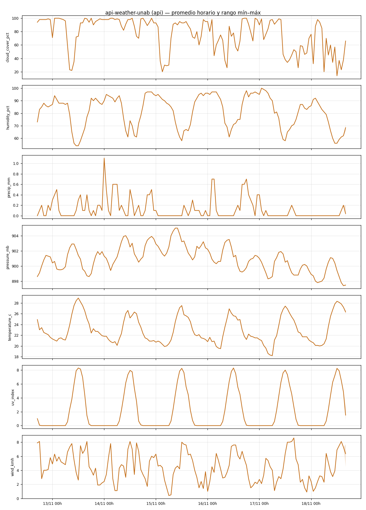{width=13.7cm}

| Variable | Promedio | Máximo | Mínimo | Momento del máximo | Momento del mínimo |
|------------------------|-------------:|-------------:|-------------:|----------------|----------------|
| cloud_cover_pct | 76.4 | 100.0 | 14.0 | 13/11 01:00 | 18/11 12:00 |
| humidity_pct | 81.2 | 100.0 | 54.0 | 17/11 01:00 | 13/11 11:00 |
| precip_mm | 0.124 | 1.1 | 0.0 | 14/11 00:00 | 12/11 17:00 |
| pressure_mb | 900.9 | 905.0 | 897.4 | 15/11 09:00 | 18/11 15:00 |
| temperature_c | 23.1 | 28.9 | 18.2 | 13/11 12:00 | 17/11 06:00 |
| uv_index | 2.1 | 8.3 | 0.0 | 13/11 12:00 | 12/11 19:00 |
| wind_kmh | 4.5 | 8.6 | 0.400 | 17/11 16:00 | 15/11 06:00 |

## 4.4 api-weather-floridablanca — Clima Floridablanca

Toma: 12/11 17:00 a 18/11 16:45 (hora de Colombia) · 148 muestras por variable.

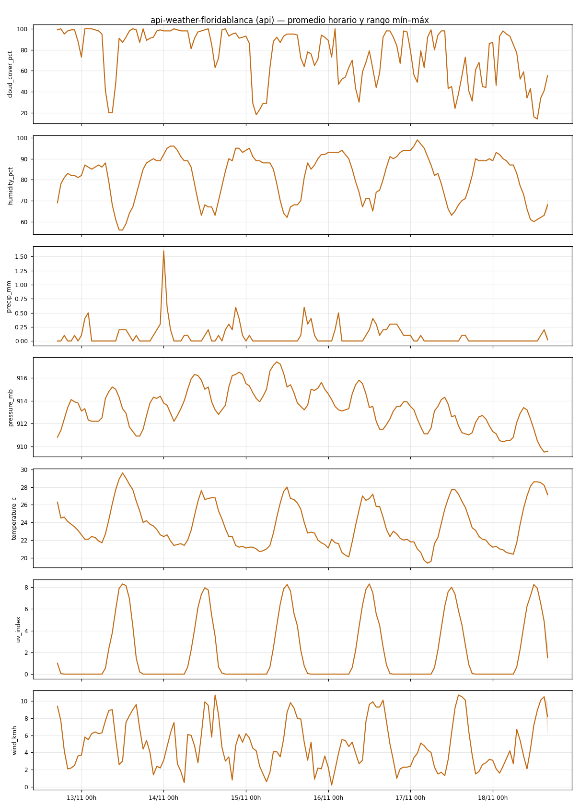{width=13.7cm}

| Variable | Promedio | Máximo | Mínimo | Momento del máximo | Momento del mínimo |
|------------------------|-------------:|-------------:|-------------:|----------------|----------------|
| cloud_cover_pct | 75.4 | 100.0 | 14.0 | 12/11 18:00 | 18/11 13:00 |
| humidity_pct | 81.0 | 99.0 | 56.0 | 17/11 02:00 | 13/11 11:00 |
| precip_mm | 0.090 | 1.6 | 0.0 | 14/11 00:00 | 12/11 17:00 |
| pressure_mb | 913.3 | 917.4 | 909.5 | 15/11 09:00 | 18/11 15:00 |
| temperature_c | 23.8 | 29.6 | 19.4 | 13/11 12:00 | 17/11 05:00 |
| uv_index | 2.1 | 8.3 | 0.0 | 13/11 12:00 | 12/11 19:00 |
| wind_kmh | 5.1 | 10.7 | 0.200 | 14/11 15:00 | 16/11 01:00 |

## 4.5 api-air-unab — Calidad del aire UNAB

Toma: 12/11 17:00 a 18/11 16:35 (hora de Colombia) · 147 muestras por variable.

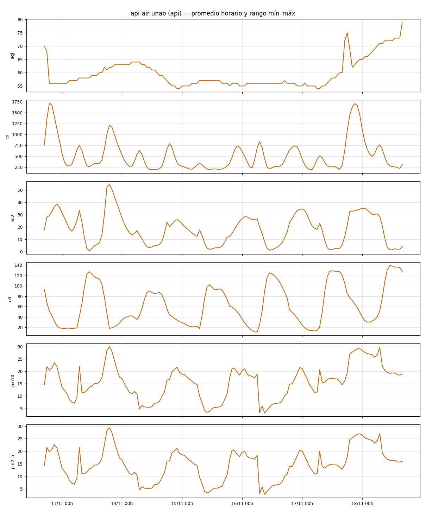{width=15cm}

| Variable | Promedio | Máximo | Mínimo | Momento del máximo | Momento del mínimo |
|------------------------|-------------:|-------------:|-------------:|----------------|----------------|
| aqi | 60.1 | 79.0 | 54.0 | 18/11 16:00 | 14/11 22:00 |
| co | 508.6 | 1 712 | 188.0 | 12/11 19:00 | 17/11 03:00 |
| no2 | 18.0 | 54.7 | 0.700 | 13/11 19:00 | 13/11 11:00 |
| o3 | 64.1 | 139.0 | 11.0 | 18/11 11:00 | 16/11 05:00 |
| pm10 | 15.7 | 30.0 | 3.1 | 13/11 19:00 | 16/11 09:00 |
| pm2_5 | 14.8 | 29.3 | 2.9 | 13/11 19:00 | 16/11 09:00 |

## 4.6 twin-greenhouse-01 — Invernadero con riego

Toma: 12/11 16:50 a 18/11 16:46 (hora de Colombia) · 5 027 muestras por variable.

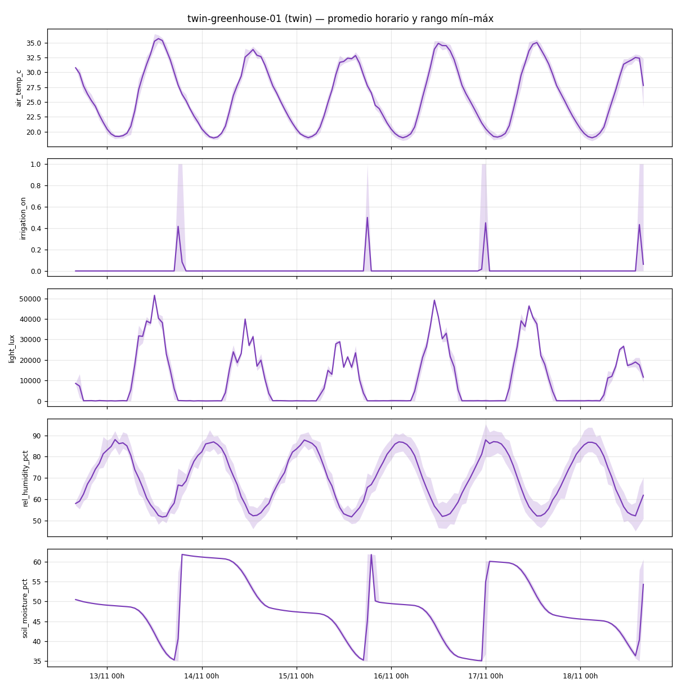{width=15cm}

| Variable | Promedio | Máximo | Mínimo | Momento del máximo | Momento del mínimo |
|------------------------|-------------:|-------------:|-------------:|----------------|----------------|
| air_temp_c | 25.8 | 36.5 | 18.4 | 13/11 12:50 | 18/11 03:21 |
| irrigation_on | 0.014 | 1.0 | 0.0 | 13/11 18:35 | 12/11 16:50 |
| light_lux | 11 208 | 52 168 | 0.0 | 13/11 12:15 | 12/11 18:00 |
| rel_humidity_pct | 70.4 | 95.3 | 45.2 | 17/11 00:18 | 18/11 14:07 |
| soil_moisture_pct | 47.3 | 61.9 | 35.0 | 13/11 19:00 | 15/11 18:20 |

## 4.7 twin-hvac-aula-01 — Aula climatizada

Toma: 12/11 16:50 a 18/11 16:46 (hora de Colombia) · 5 028 muestras por variable.

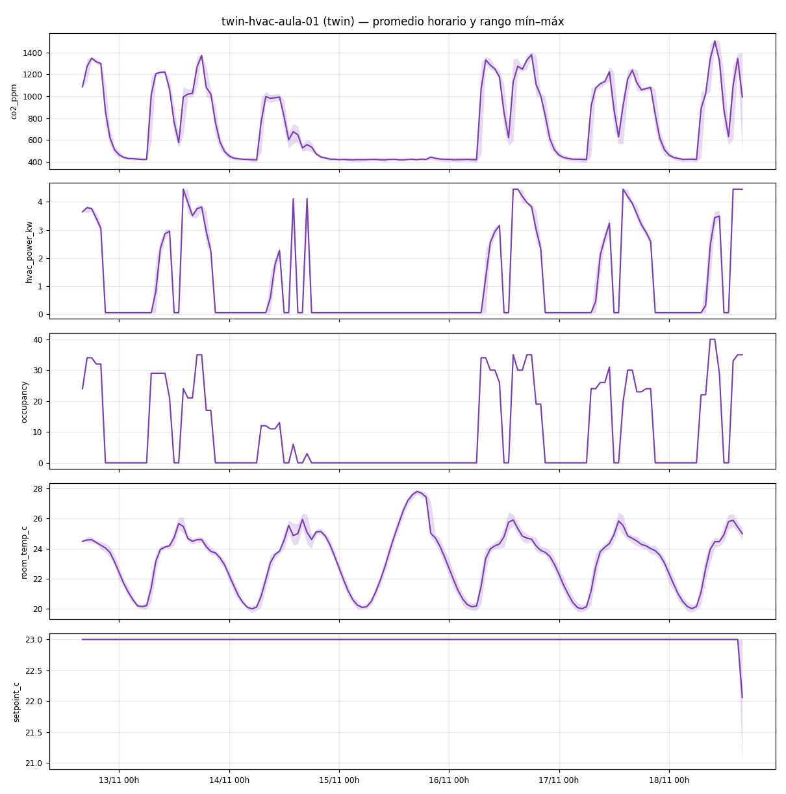{width=15cm}

| Variable | Promedio | Máximo | Mínimo | Momento del máximo | Momento del mínimo |
|------------------------|-------------:|-------------:|-------------:|----------------|----------------|
| co2_ppm | 787.9 | 1 522 | 392.1 | 18/11 10:47 | 16/11 06:09 |
| hvac_power_kw | 1.3 | 4.5 | 0.050 | 13/11 14:00 | 12/11 21:00 |
| occupancy | 12.1 | 40.0 | 0.0 | 18/11 09:00 | 12/11 21:00 |
| room_temp_c | 23.2 | 27.9 | 19.7 | 15/11 17:55 | 14/11 05:40 |
| setpoint_c | 23.0 | 23.0 | 21.0 | 12/11 16:50 | 18/11 16:25 |

## 4.8 twin-solar-01 — Panel solar + batería

Toma: 12/11 16:50 a 18/11 16:46 (hora de Colombia) · 5 027 muestras por variable.

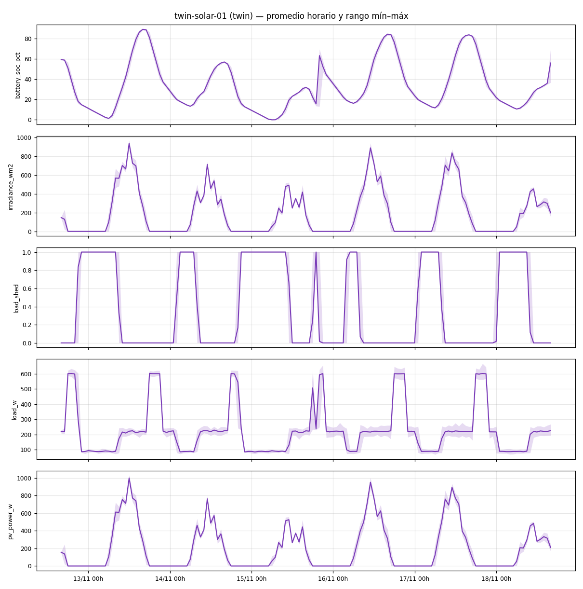{width=15cm}

| Variable | Promedio | Máximo | Mínimo | Momento del máximo | Momento del mínimo |
|------------------------|-------------:|-------------:|-------------:|----------------|----------------|
| battery_soc_pct | 37.0 | 89.7 | 0.0 | 13/11 16:50 | 15/11 05:50 |
| irradiance_wm2 | 193.9 | 966.2 | 0.0 | 13/11 12:30 | 12/11 18:00 |
| load_shed | 0.321 | 1.0 | 0.0 | 12/11 21:10 | 12/11 16:50 |
| load_w | 233.3 | 666.3 | 68.0 | 17/11 20:12 | 17/11 06:14 |
| pv_power_w | 207.7 | 1 031 | 0.0 | 13/11 12:25 | 12/11 18:00 |

## 4.9 twin-tank-01 — Tanque + bomba

Toma: 12/11 16:50 a 18/11 16:46 (hora de Colombia) · 5 090 muestras por variable.

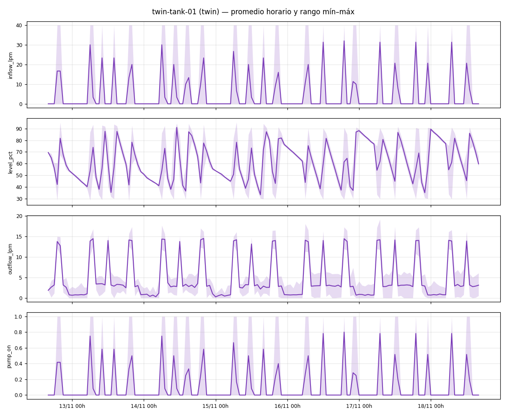{width=15cm}

| Variable | Promedio | Máximo | Mínimo | Momento del máximo | Momento del mínimo |
|------------------------|-------------:|-------------:|-------------:|----------------|----------------|
| inflow_lpm | 4.5 | 40.0 | 0.0 | 12/11 19:35 | 12/11 16:50 |
| level_pct | 64.1 | 95.4 | 28.1 | 15/11 07:05 | 13/11 19:35 |
| outflow_lpm | 4.5 | 19.2 | 0.0 | 17/11 07:44 | 12/11 23:00 |
| pump_on | 0.112 | 1.0 | 0.0 | 12/11 19:35 | 12/11 16:50 |

## 4.10 ds-office-a — Oficina A (UCI)

Toma: 12/11 16:47 a 18/11 16:46 (hora de Colombia) · 6 383 muestras por variable.

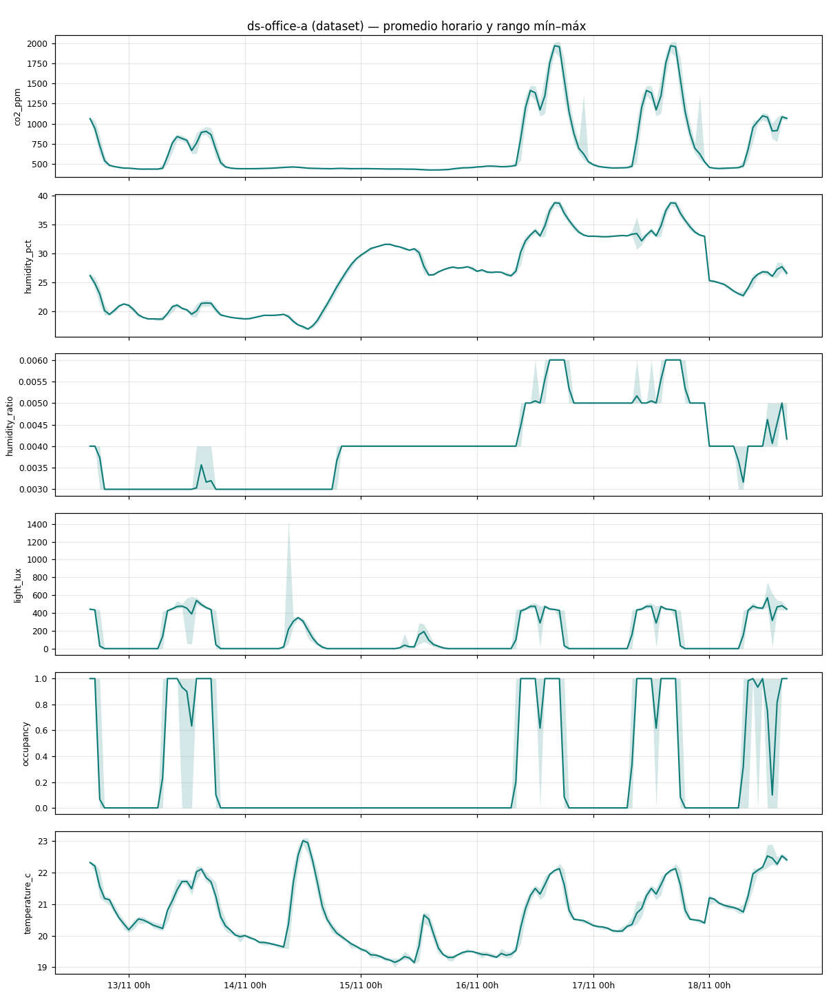{width=15cm}

| Variable | Promedio | Máximo | Mínimo | Momento del máximo | Momento del mínimo |
|------------------------|-------------:|-------------:|-------------:|----------------|----------------|
| co2_ppm | 734.5 | 2 028 | 413.0 | 16/11 17:05 | 15/11 16:25 |
| humidity_pct | 27.9 | 39.1 | 16.8 | 16/11 17:19 | 14/11 13:27 |
| humidity_ratio | 0.004 | 0.006 | 0.003 | 16/11 12:20 | 12/11 18:45 |
| light_lux | 150.7 | 1 452 | 0.0 | 14/11 09:43 | 12/11 18:05 |
| occupancy | 0.293 | 1.0 | 0.0 | 12/11 16:47 | 12/11 18:05 |
| temperature_c | 20.7 | 23.1 | 19.0 | 14/11 12:39 | 15/11 07:29 |

## 4.11 ds-office-b — Oficina B (UCI)

Toma: 12/11 16:47 a 18/11 16:46 (hora de Colombia) · 6 379 muestras por variable.

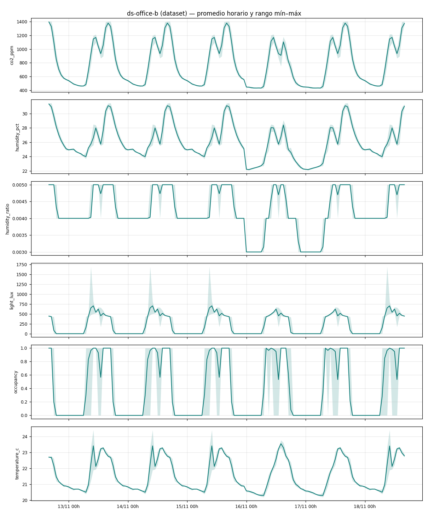{width=15cm}

| Variable | Promedio | Máximo | Mínimo | Momento del máximo | Momento del mínimo |
|------------------------|-------------:|-------------:|-------------:|----------------|----------------|
| co2_ppm | 766.6 | 1 402 | 427.5 | 12/11 17:03 | 16/11 02:49 |
| humidity_pct | 25.9 | 31.5 | 22.1 | 12/11 17:03 | 16/11 01:29 |
| humidity_ratio | 0.004 | 0.005 | 0.003 | 12/11 16:47 | 16/11 00:00 |
| light_lux | 221.1 | 1 697 | 0.0 | 13/11 09:41 | 12/11 18:13 |
| occupancy | 0.406 | 1.0 | 0.0 | 12/11 16:47 | 12/11 18:13 |
| temperature_c | 21.5 | 24.4 | 20.2 | 13/11 10:43 | 16/11 07:00 |

## 4.12 ds-office-c — Oficina C (UCI)

Toma: 12/11 16:47 a 18/11 16:46 (hora de Colombia) · 6 383 muestras por variable.

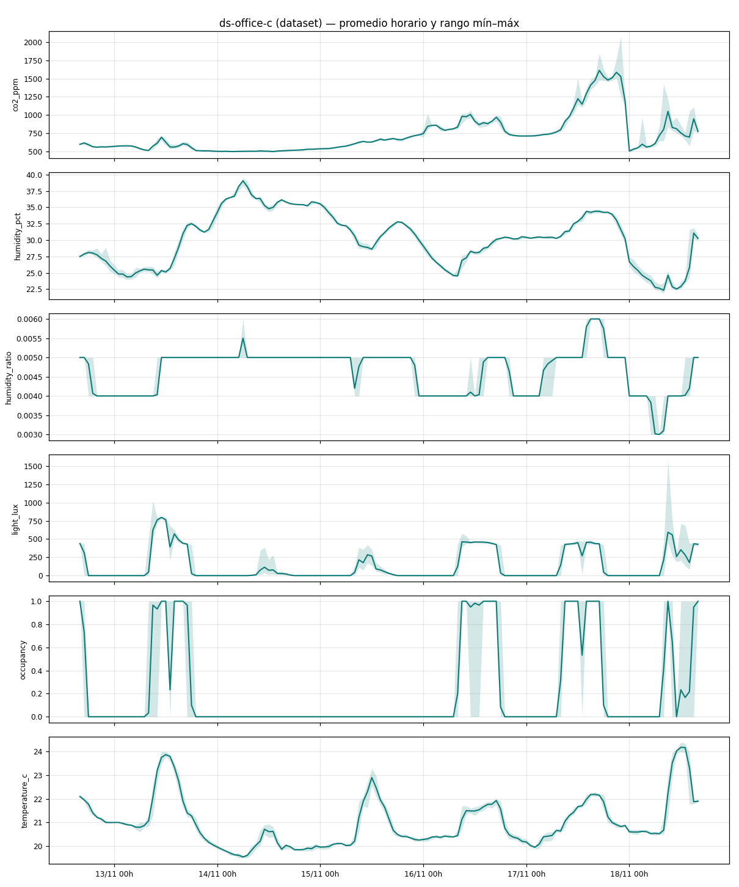{width=15cm}

| Variable | Promedio | Máximo | Mínimo | Momento del máximo | Momento del mínimo |
|------------------------|-------------:|-------------:|-------------:|----------------|----------------|
| co2_ppm | 778.9 | 2 072 | 492.8 | 17/11 22:56 | 14/11 13:01 |
| humidity_pct | 29.7 | 39.5 | 21.9 | 14/11 06:37 | 18/11 08:33 |
| humidity_ratio | 0.005 | 0.006 | 0.003 | 14/11 06:29 | 18/11 05:04 |
| light_lux | 142.7 | 1 581 | 0.0 | 18/11 09:47 | 12/11 17:45 |
| occupancy | 0.255 | 1.0 | 0.0 | 12/11 16:47 | 12/11 17:45 |
| temperature_c | 21.0 | 24.4 | 19.5 | 18/11 12:46 | 14/11 05:55 |


## 4.13 Evidencia del retroceso

Comandos aplicados desde el panel web, registrados por la plataforma en la medida `device_state` (`retroceso.csv`):

| Hora (18/11) | Dispositivo | Parámetro | Antes | Después | Acción |
|---|---|---|---|---|---|
| 16:24:41 | ds-office-b | power | 1 | 0 | Apagado |
| 16:25:00 | twin-hvac-aula-01 | setpoint_c | 23 | 21 | Ajuste de consigna |
| 16:25:29 | twin-tank-01 | period_s | 60 | 15 | Cambio de periodo de muestreo |
| 16:28:53 | ds-office-b | power | 0 | 1 | Encendido |
| 16:35:06 | twin-tank-01, twin-hvac-aula-01 | period_s, setpoint_c | 60 / 23 | 15 / 21 | Reaplicación automática tras reiniciar el servicio |

ds-office-b dejó de publicar durante 4 min 12 s y volvió solo con el comando de encendido. A las 16:35 se reinició el contenedor `devices` para actualizarlo. Los gemelos arrancaron con su configuración de fábrica y en el mismo segundo recuperaron la consigna de 21 °C y el periodo de 15 s, porque los comandos se publican como mensajes **retenidos** de MQTT. La calibración (`offset`/`gain`) está implementada para todas las variables y se demuestra en vivo en la sustentación.

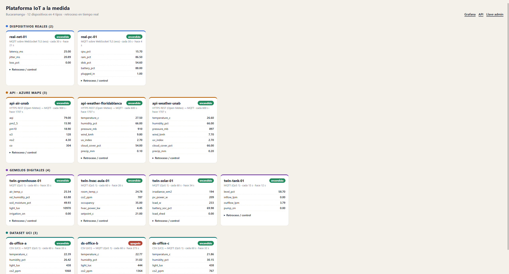{width=16cm}

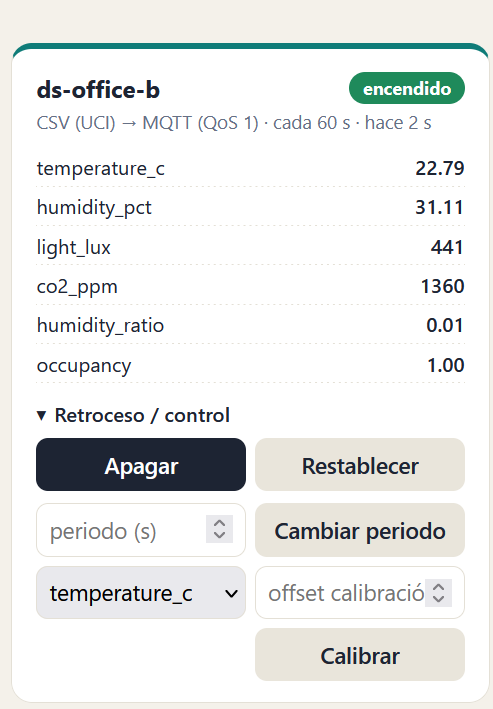{width=6cm}

## 4.14 Alertas registradas

Grafana evalúa 8 reglas cada minuto. Cada disparo y cada resolución llegan por webhook al backend, que los guarda en InfluxDB (`alertas.csv`):

| Regla | Disparos | Resoluciones | Patrón |
|---|---:|---:|---|
| CO₂ alto en el aula (> 1000 ppm) | 11 | 6 | Mañana y tarde de los días con clase |
| Invernadero sobre 32 °C | 6 | 4 | Mediodía de los días soleados |
| Batería solar baja (SOC < 20 %) | 6 | 3 | Madrugada, antes de que salga el sol |
| CO₂ alto en oficina C (> 1200 ppm) | 5 | 3 | Horas de ocupación del registro UCI |
| CPU alta, latencia alta, PM2.5 > 35, tanque < 15 % | 0 | 0 | Las variables nunca cruzaron el umbral |
| DatasourceError (automática de Grafana) | 14 | 6 | Los días 18/11 a las 11:02 y a las 16:32, cuando InfluxDB no respondió durante el reinicio de contenedores |

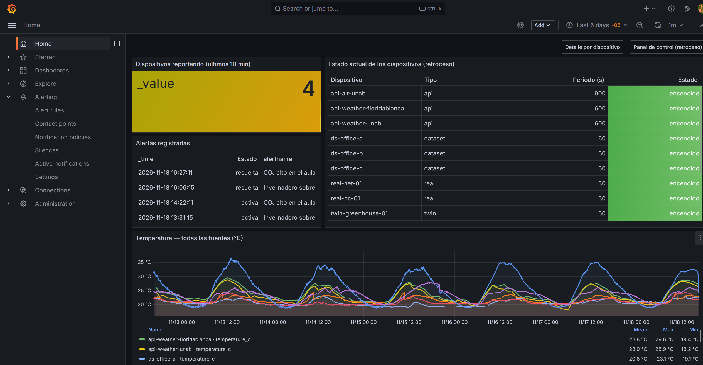{width=16cm}

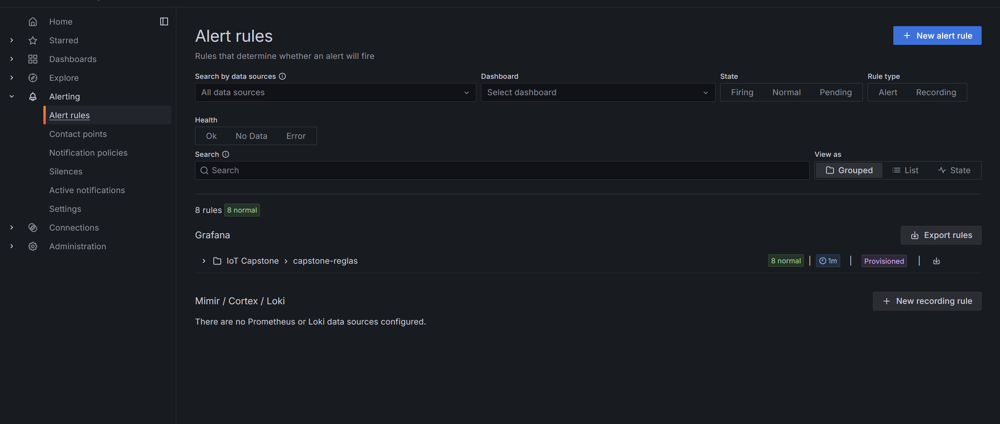{width=16cm}

# 5. Análisis de gráficas y comportamiento

**Clima (API).** Las dos estaciones muestran un ciclo diario muy marcado. En la UNAB la temperatura fue de 18.2 °C (17/11, 06:00) a 28.9 °C (13/11, 12:00), con promedio de 23.1 °C. La humedad relativa se mueve al revés: llega a 99–100 % de madrugada y baja a 54 % al mediodía. Floridablanca fue en promedio 0.7 °C más cálida y su presión en superficie fue 12 hPa mayor (913 contra 901 hPa), lo que corresponde a unos 100 m menos de altitud del punto de la grilla. La nubosidad fue alta (76 % en promedio), la lluvia fue débil (máximo 1.1–1.6 mm/h la noche del 13 al 14/11) y el índice UV llegó a 8.3 el 13/11, el día más despejado y caliente. Los máximos de temperatura y de UV coinciden con ese día de menor nubosidad.

**Calidad del aire (API).** El AQI (escala de EE. UU.) estuvo entre 54 y 79, en la categoría "moderada" todo el periodo. El PM2.5 promedió 14.8 µg/m³, justo por debajo de la guía diaria de la OMS (15 µg/m³), y tuvo su pico de 29.3 µg/m³ el 13/11 a las 19:00. A esa misma hora tuvieron su máximo el PM10 y el NO₂, y el CO llegó al suyo el 12/11 a las 19:00. Es el patrón del tráfico de la hora pico de la tarde. El ozono hace lo contrario: es mínimo de madrugada y máximo hacia el mediodía (139 µg/m³), porque se forma con la radiación solar. La regla de PM2.5 > 35 nunca se disparó.

**Invernadero (gemelo).** Por el efecto invernadero, el aire interior llega a 36.5 °C, unos 7 °C por encima del máximo exterior. Por eso la alerta de 32 °C se dispara casi todos los mediodías. La humedad del suelo se mantuvo entre 35 y 62 %, la banda de consignas (35–60 %). El riego estuvo encendido solo el 1.4 % del tiempo, en pulsos cortos cuando la humedad tocaba el 35 %. El control on/off con histéresis funciona sin oscilar.

**Aula climatizada (gemelo).** La temperatura del aula promedió 23.2 °C con consigna de 23 °C. El CO₂ sigue la ocupación: baja a unos 390 ppm de noche y sube hasta 1522 ppm con 40 estudiantes (18/11, 10:47). Eso disparó 11 veces la alerta de 1000 ppm, siempre en horario de clase, y muestra que la ventilación modelada no basta con el aula llena. El HVAC llegó a 4.45 kW en las tardes calurosas. Tras el retroceso del 18/11 a las 16:25, la consigna pasó a 21 °C; el promedio de la consigna (22.99 °C) refleja que estuvo en 23 °C casi toda la toma.

**Sistema solar (gemelo).** La generación FV sigue la irradiancia (hasta 966 W/m² y 1031 W) y es cero de noche. La batería oscila entre 0 y 90 % con promedio de 37 %. La carga se desconectó (`load_shed`) el 32 % del tiempo y la alerta de SOC < 20 % se repitió cada madrugada. Conclusión de diseño: con una carga base de 220 W y picos de 600 W en la noche, el banco de baterías está subdimensionado. Habría que aumentar su capacidad o bajar la carga nocturna. El salto de SOC del 15/11 a las 20:05 no es un dato real: es el arranque en vivo del gemelo, que inicia con SOC = 70 %. Una mejora para la plataforma es guardar el estado interno de los gemelos entre reinicios.

**Tanque y bomba (gemelo).** El nivel se movió entre 28 y 95 % (promedio 64 %). La bomba arranca al bajar del 30 % y para al 90 %, y estuvo encendida el 11 % del tiempo. El mínimo (28 %) queda un poco por debajo del umbral porque la bomba reacciona en el siguiente ciclo. La alerta de tanque casi vacío (< 15 %) nunca se activó. El cambio de periodo a 15 s se ve en el aumento de muestras: 5090 frente a unas 5027 de los otros gemelos.

**Oficinas (DataSet UCI).** Las tres oficinas muestran el mismo patrón diario: CO₂ e iluminación suben en horario laboral y caen de noche, y la ocupación media fue de 29 % (A), 41 % (B) y 26 % (C). En las oficinas A y C el CO₂ llega a unos 2000 ppm (2028 y 2072 ppm), lo que disparó 5 veces la regla de la oficina C (> 1200 ppm). La B tuvo un máximo menor (1402 ppm). La luz llega a 1450–1700 lux cuando hay gente y a 0 lux de noche. La temperatura se mantiene en una banda estrecha de 19–24.4 °C porque es un edificio climatizado. El apagado de ds-office-b se ve como un hueco de 4 minutos en su serie del 18/11.

**Dispositivos reales.** En los 23 minutos de toma, el computador tuvo una CPU de 5 a 31 % (promedio 11.7 %) y una RAM alta y estable (80–87.5 %), lo que indica que el equipo trabaja cerca de su límite de memoria. Estuvo conectado a la corriente con la batería fija en 88 %. La conexión a Internet tuvo una latencia de 18 a 42 ms (promedio 25.5 ms), un jitter de unos 22 ms y 0 % de pérdida. Las reglas de CPU > 85 % y latencia > 150 ms no se activaron.

**Conclusiones.**

- La plataforma integró 12 dispositivos de 4 tipos con protocolos distintos (MQTT/WSS, HTTPS REST → MQTT, CSV → MQTT) en un mismo modelo de temas.
- Calculó promedio, máximo y mínimo para cualquier rango de tiempo y registró 64 eventos de alerta con su hora.
- Aplicó retroceso real sobre los dispositivos: los comandos retenidos sobreviven a un reinicio del servicio.
- Las alertas que se dispararon (CO₂ del aula, invernadero caliente y batería baja) señalan decisiones concretas para el campus: ventilar o limitar el aforo, dar sombra o ventilar el invernadero, y ampliar el almacenamiento solar.

# 6. Referencias

- Open-Meteo. (2026). *Weather Forecast API* y *Air Quality API*. <https://open-meteo.com/en/docs>
- Zippenfenig, P. (2023). *Open-Meteo.com Weather API*. Zenodo. <https://doi.org/10.5281/zenodo.7970649>
- Microsoft. (2025). *Azure Maps Weather REST API* (proveedor alterno soportado por el adaptador). <https://learn.microsoft.com/es-es/rest/api/maps/weather>
- Candanedo, L. M., & Feldheim, V. (2016). Accurate occupancy detection of an office room from light, temperature, humidity and CO₂ measurements using statistical learning models. *Energy and Buildings, 112*, 28–39. Dataset: UCI Machine Learning Repository.
- OASIS. (2014). *MQTT Version 3.1.1*. OASIS Standard.
- Eclipse Foundation. *Eclipse Mosquitto documentation*. <https://mosquitto.org/documentation/>
- InfluxData. *InfluxDB 2.7 documentation*. <https://docs.influxdata.com/influxdb/v2/>
- Grafana Labs. *Grafana Alerting documentation*. <https://grafana.com/docs/grafana/latest/alerting/>
- Grieves, M., & Vickers, J. (2017). Digital Twin: Mitigating unpredictable, undesirable emergent behavior in complex systems. *Transdisciplinary Perspectives on Complex Systems*, Springer.
- Organización Mundial de la Salud. (2021). *Directrices mundiales sobre la calidad del aire*.
