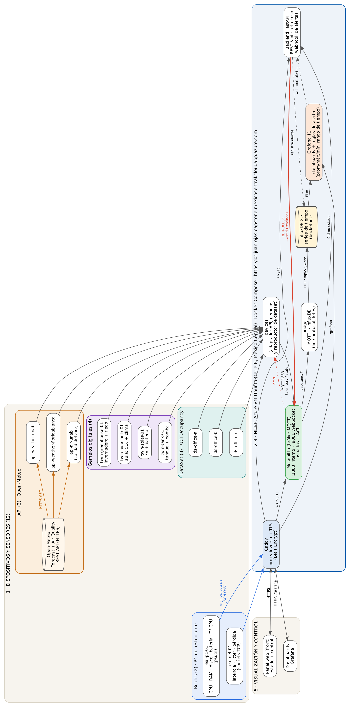

**Repositorio:** <https://github.com/jrojas710/iot-capstone>  
**Plataforma (URL propia):** <https://iot-juanrojas-capstone.mexicocentral.cloudapp.azure.com> · Grafana: `/grafana` · API: `/api/docs`

# 1. Descripción y contexto

El escenario es un **campus universitario inteligente en Bucaramanga (UNAB)**. Una sola plataforma reúne la información ambiental y de infraestructura del campus para tomar decisiones de confort, ahorro de energía y agua y salud ambiental:

- **Clima y calidad del aire** del campus y de Floridablanca, a partir del servicio meteorológico abierto Open-Meteo (observaciones horarias y modelo de calidad del aire CAMS).
- **Infraestructura simulada por gemelos digitales:** un invernadero con riego automático, un aula climatizada con control de CO₂, un sistema solar con batería para una caseta y un tanque de agua con bomba. Los gemelos usan como entrada el clima real de la API.
- **Oficinas con sensores ambientales** de ocupación, CO₂, luz, temperatura y humedad, reproducidas desde un dataset científico público.
- **Equipos reales:** el computador del estudiante, que mide su propio estado (CPU, RAM, batería y temperatura) y la calidad de su conexión a Internet.

Cada dispositivo es controlable desde la nube (**retroceso**): se puede apagar, encender, cambiar su periodo de muestreo, calibrar con offset o ganancia y ajustar sus consignas (por ejemplo, la temperatura objetivo del aula o el umbral de riego).

# 2. Arquitectura de referencia IoT

```{=openxml}
<w:p><w:r><w:br w:type="page"/></w:r></w:p>
```

{height=20cm}

| Capa | Componentes | Función |
|---|---|---|
| 1. Dispositivos y sensores | 2 reales, 3 API, 4 gemelos, 3 DataSet | Generan las variables (12 dispositivos, 56 variables) |
| 2. Comunicación | MQTT 3.1.1 (TCP 1883 y WebSocket TLS 443), HTTPS REST | Envío de telemetría y recepción de comandos |
| 3. Plataforma / bróker | Mosquitto con usuarios y ACL, Caddy (TLS) | Enrutamiento publicar/suscribir, seguridad y punto de entrada único |
| 4. Procesamiento y almacenamiento | Bridge Python, InfluxDB 2.7, backend FastAPI | Persistencia de series de tiempo, API de control y registro de alertas |
| 5. Visualización y control | Grafana 11, panel web propio | Dashboards con promedio, máximo y mínimo, alertas y retroceso |

# 3. Tecnologías seleccionadas

## 3.1 Sensores y dispositivos

| # | Dispositivo | Protocolo | Variables (unidad, rango) | Periodo |
|--|------------------|-------------|------------------------------------------------|------|
| 1 | **real-pc-01** — Real: Equipo del estudiante | MQTT/WSS (TLS 443) | cpu_pct (%, 0–100) · ram_pct (%, 0–100) · disk_pct (%, 0–100) · battery_pct (%, 0–100) · cpu_temp_c (°C, 30–100) · plugged_in (0/1, 0–1) | 30 s |
| 2 | **real-net-01** — Real: Conexión a Internet | MQTT/WSS (TLS 443) | latency_ms (ms, 0–500) · jitter_ms (ms, 0–200) · loss_pct (%, 0–100) | 30 s |
| 3 | **api-weather-unab** — API: Clima UNAB | HTTPS REST → MQTT | temperature_c (°C, 10–35) · humidity_pct (%, 20–100) · pressure_mb (mb, 1000–1025) · wind_kmh (km/h, 0–40) · uv_index (índice, 0–14) · cloud_cover_pct (%, 0–100) · precip_mm (mm/h, 0–30) | 600 s |
| 4 | **api-weather-floridablanca** — API: Clima Floridablanca | HTTPS REST → MQTT | temperature_c (°C, 10–35) · humidity_pct (%, 20–100) · pressure_mb (mb, 1000–1025) · wind_kmh (km/h, 0–40) · uv_index (índice, 0–14) · cloud_cover_pct (%, 0–100) · precip_mm (mm/h, 0–30) | 600 s |
| 5 | **api-air-unab** — API: Calidad del aire UNAB | HTTPS REST → MQTT | aqi (índice, 0–300) · pm2_5 (µg/m³, 0–150) · pm10 (µg/m³, 0–250) · o3 (µg/m³, 0–200) · no2 (µg/m³, 0–200) · co (µg/m³, 0–2000) | 900 s |
| 6 | **twin-greenhouse-01** — Gemelo: Invernadero con riego | MQTT (QoS 1) | air_temp_c (°C, 15–40) · rel_humidity_pct (%, 30–100) · soil_moisture_pct (%, 0–100) · light_lux (lux, 0–60000) · irrigation_on (0/1, 0–1) | 60 s |
| 7 | **twin-hvac-aula-01** — Gemelo: Aula climatizada | MQTT (QoS 1) | room_temp_c (°C, 18–32) · co2_ppm (ppm, 400–2000) · occupancy (personas, 0–40) · hvac_power_kw (kW, 0–5) · setpoint_c (°C, 18–28) | 60 s |
| 8 | **twin-solar-01** — Gemelo: Panel solar + batería | MQTT (QoS 1) | irradiance_wm2 (W/m², 0–1100) · pv_power_w (W, 0–1200) · load_w (W, 0–900) · battery_soc_pct (%, 0–100) · load_shed (0/1, 0–1) | 60 s |
| 9 | **twin-tank-01** — Gemelo: Tanque + bomba | MQTT (QoS 1) | level_pct (%, 0–100) · inflow_lpm (L/min, 0–60) · outflow_lpm (L/min, 0–40) · pump_on (0/1, 0–1) | 60 s |
| 10 | **ds-office-a** — DataSet: Oficina A (UCI) | CSV → MQTT | temperature_c (°C, 19–25) · humidity_pct (%, 16–40) · light_lux (lux, 0–1700) · co2_ppm (ppm, 410–2080) · humidity_ratio (kg/kg, 0.0026–0.0065) · occupancy (0/1, 0–1) | 60 s |
| 11 | **ds-office-b** — DataSet: Oficina B (UCI) | CSV → MQTT | temperature_c (°C, 19–25) · humidity_pct (%, 16–40) · light_lux (lux, 0–1700) · co2_ppm (ppm, 410–2080) · humidity_ratio (kg/kg, 0.0026–0.0065) · occupancy (0/1, 0–1) | 60 s |
| 12 | **ds-office-c** — DataSet: Oficina C (UCI) | CSV → MQTT | temperature_c (°C, 19–25) · humidity_pct (%, 16–40) · light_lux (lux, 0–1700) · co2_ppm (ppm, 410–2080) · humidity_ratio (kg/kg, 0.0026–0.0065) · occupancy (0/1, 0–1) | 60 s |

**Resumen:** 12 dispositivos (2 reales, 3 API, 4 gemelos digitales, 3 DataSet), todos con varias variables, comunicación MQTT y retroceso.

## 3.2 Comunicación: bróker y protocolo

**Bróker:** Eclipse Mosquitto 2.0. Rechaza conexiones anónimas y tiene cuatro usuarios con permisos mínimos: `bridge` (solo lectura), `backend` y `cloud-devices` (lectura y escritura) y `real-device`. Este último solo puede publicar en `capstone/real/+/telemetry|state` y leer `capstone/real/+/cmd`.

**Protocolo:** MQTT con mensajes JSON.

- **Envío** (dispositivo → nube): `capstone/<tipo>/<id>/telemetry` con QoS 1, que garantiza que el mensaje llegue al menos una vez. El estado del dispositivo va en `.../state` como mensaje retenido.
- **Recepción** (nube → dispositivo): `capstone/<tipo>/<id>/cmd` con QoS 1 y **retained**. Si el dispositivo está desconectado, aplica el último comando cuando se reconecta.
- **Transporte:**
  - Los dispositivos reales salen de una red doméstica, así que usan **MQTT sobre WebSocket con TLS** (`wss://<dominio>/mqtt`, puerto 443).
  - Los servicios internos usan **MQTT/TCP 1883** dentro de la red de Docker.
  - Los dispositivos API consultan Open-Meteo por **HTTPS REST** (`GET /v1/forecast?current=...` y `GET /v1/air-quality?current=...`) y un adaptador traduce la respuesta a MQTT. El adaptador también soporta Azure Maps Weather (`API_PROVIDER=azure`), pero la llave entregada para el curso respondía `401 Unauthorized` y la suscripción Azure for Students no permite crear una cuenta propia de Azure Maps en ninguna región habilitada, así que se usó Open-Meteo, que no requiere llave.

Ejemplo de mensaje:
```
capstone/twin/twin-hvac-aula-01/telemetry
{"device":"twin-hvac-aula-01","kind":"twin","ts":1794788631995,
 "values":{"room_temp_c":24.1,"co2_ppm":812,"occupancy":28,"hvac_power_kw":2.3,"setpoint_c":23}}
```

## 3.3 Nube y servicios utilizados

Infraestructura propia en **Microsoft Azure** (Azure for Students):

- **Máquina:** una VM Ubuntu 24.04 de 2 vCPU y 4 GB (serie B) en la región **México Central**, con IP pública y un nombre DNS propio (`iot-juanrojas-capstone.mexicocentral.cloudapp.azure.com`). La región se eligió porque la política de la suscripción Azure for Students solo permite westus, mexicocentral, brazilsouth, centralus y chilecentral. El grupo de seguridad de red solo abre los puertos 80 y 443.
- **Despliegue:** se hace con Azure CLI y cloud-init (`infra/deploy_azure.sh`).
- **Contenedores:** todo el stack corre con Docker Compose.

| Servicio | Imagen / tecnología | Rol |
|---|---|---|
| caddy | Caddy 2.8 | Proxy inverso y certificado HTTPS automático (Let's Encrypt) |
| mosquitto | Eclipse Mosquitto 2.0 | Bróker MQTT (TCP y WebSocket) |
| devices | Python 3.12 | Adaptador de la API Open-Meteo, 4 gemelos y 3 reproductores de dataset |
| bridge | Python 3.12 | Suscriptor `capstone/#` que escribe en InfluxDB por lotes |
| influxdb | InfluxDB 2.7 | Base de datos de series de tiempo (retención de 60 días) |
| backend | FastAPI + Uvicorn | API REST, retroceso, caché del último estado y webhook de alertas |
| grafana | Grafana OSS 11.2 | Dashboards y reglas de alerta, provisionados como código |
| Open-Meteo | Forecast y Air Quality REST API | Fuente de los dispositivos API (sin llave) |

## 3.4 Visualización y procesamiento de los datos

- **Dashboard "Visión general":**
  - dispositivos que están reportando, por tipo;
  - tabla con el estado actual de cada dispositivo (encendido o apagado, periodo);
  - alertas registradas;
  - gráficas comparativas: temperatura de todas las fuentes, humedad, CO₂, CPU/RAM y latencia de los equipos reales, PM2.5/PM10, energía solar, nivel de agua y luz de las oficinas.
- **Dashboard "Detalle por dispositivo":**
  - selector de dispositivo y de variables;
  - **tabla con promedio, máximo, mínimo, último valor y número de muestras** del rango seleccionado;
  - línea de estado (encendido/apagado) que evidencia el retroceso;
  - una gráfica por variable con **promedio, máximo y mínimo** por ventana.
- **Ajuste de tiempo:** el selector de Grafana (por defecto *últimos 6 días*) recalcula todas las estadísticas y la agregación (`aggregateWindow` según `v.windowPeriod`).
- **Alertas y reglas** (Grafana Alerting): se evalúan cada minuto y deben sostenerse 2 minutos para dispararse. La notificación va por webhook al backend, que la registra en InfluxDB.

| Regla | Condición |
|---|---|
| CPU alta (real-pc-01) | promedio de 10 min > 85 % |
| Latencia alta (real-net-01) | > 150 ms |
| PM2.5 (api-air-unab) | > 35 µg/m³ |
| Invernadero caliente | > 32 °C |
| CO₂ en el aula | > 1000 ppm |
| Batería solar baja | SOC < 20 % |
| Tanque casi vacío | nivel < 15 % |
| CO₂ en la oficina C (dataset) | > 1200 ppm |

**Retroceso:** se usa desde el panel web (`/`) o desde la API (`POST /api/devices/{id}/cmd` con llave de administración).

| Comando | Efecto |
|---|---|
| `{"power":"off"}` / `{"power":"on"}` | Apaga o enciende el envío de datos |
| `{"period_s":10}` | Cambia el periodo de muestreo |
| `{"offset":{"cpu_pct":-2}}` / `{"gain":{...}}` | Calibración aditiva o multiplicativa |
| `{"setpoint":{"setpoint_c":22}}` | Ajusta las consignas de los gemelos (temperatura del aula, umbrales de riego y de la bomba, SOC mínimo) |
| `{"reset":true}` | Vuelve a la configuración de fábrica |

# 4. Toma de datos

| Origen | Periodo de la toma | Cómo se obtuvieron los datos |
|---|---|---|
| Reales | [inicio] a [fin] | Medición en vivo del computador del estudiante |
| API | [inicio] a [fin] | Consulta en vivo a Azure Maps, más las 24 h previas al despliegue (`duration=24`) |
| Gemelos | [inicio − 5 días] a [fin] | Simulación: los 5 días previos al despliegue se generaron con el perfil climático típico y desde el despliegue el modelo usa el clima real de la API |
| DataSet | [inicio − 5 días] a [fin] | Reproducción del registro UCI de 2015, alineado por hora del día y día de la semana |

*Las gráficas y estadísticas de cada dispositivo salen de `exportar.py` (carpeta `evidencias/` del repositorio).*

[Sección por completar con la exportación de la plataforma: una gráfica por dispositivo y su tabla de promedio, máximo y mínimo.]

# 5. Análisis de gráficas y comportamiento

[Sección por completar a partir de `evidencias/resumen.json` y las gráficas exportadas.]

# 6. Referencias

- Open-Meteo. (2026). *Weather Forecast API* y *Air Quality API*. <https://open-meteo.com/en/docs>
- Zippenfenig, P. (2023). *Open-Meteo.com Weather API*. Zenodo. <https://doi.org/10.5281/zenodo.7970649>
- Microsoft. (2025). *Azure Maps Weather REST API* (proveedor alterno soportado por el adaptador). <https://learn.microsoft.com/es-es/rest/api/maps/weather>
- Candanedo, L. M., & Feldheim, V. (2016). Accurate occupancy detection of an office room from light, temperature, humidity and CO₂ measurements using statistical learning models. *Energy and Buildings, 112*, 28–39. Dataset: UCI Machine Learning Repository.
- OASIS. (2014). *MQTT Version 3.1.1*. OASIS Standard.
- Eclipse Foundation. *Eclipse Mosquitto documentation*. <https://mosquitto.org/documentation/>
- InfluxData. *InfluxDB 2.7 documentation*. <https://docs.influxdata.com/influxdb/v2/>
- Grafana Labs. *Grafana Alerting documentation*. <https://grafana.com/docs/grafana/latest/alerting/>
- Grieves, M., & Vickers, J. (2017). Digital Twin: Mitigating unpredictable, undesirable emergent behavior in complex systems. *Transdisciplinary Perspectives on Complex Systems*, Springer.
- Organización Mundial de la Salud. (2021). *Directrices mundiales sobre la calidad del aire*.
